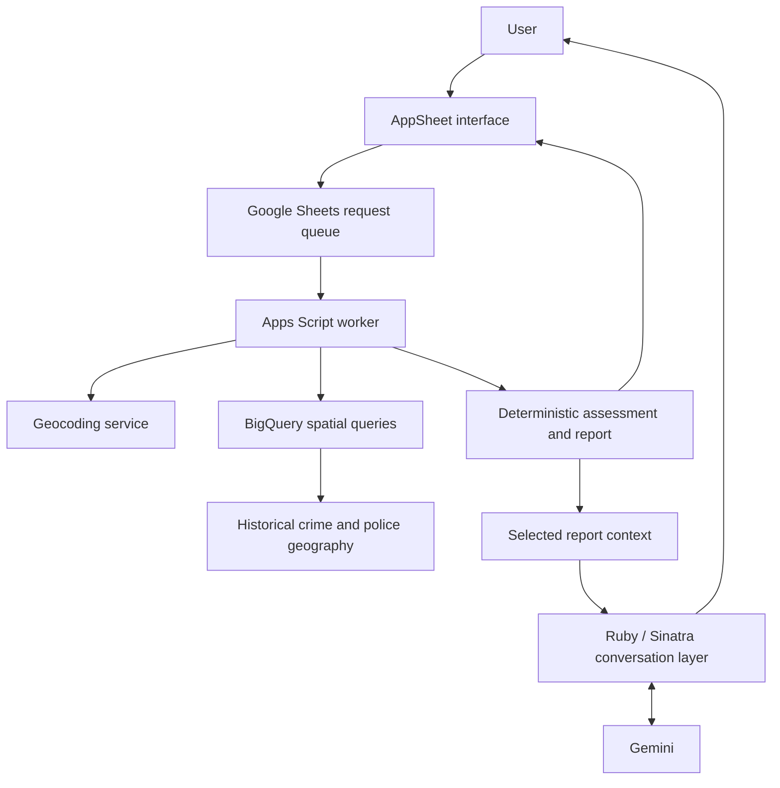

# Hooty — Safety Intelligence MVP

**From an address to an explainable safety report, with contextual AI questions and answers.**

Hooty is a safety intelligence prototype built by Stanford Gibson. It explores how historical crime records, geospatial queries and a conversational interface can help people understand an unfamiliar area.

The MVP was developed and demonstrated in 2026. This repository presents the product, its architecture, engineering decisions and limitations. It does not contain the private application source, operational credentials or underlying incident dataset.

> **Status:** Previously demonstrated MVP. Current deployment availability has not been reverified for this showcase. Historical crime patterns do not establish that a place is safe now.

## Why I built it

Safety questions often involve an unfamiliar address and little context. I wanted to turn a location search into a structured report that a person could understand and ask questions about, while keeping the calculations separate from AI-generated explanations.

## What the MVP does

1. Accepts a destination address and search radius.
2. Resolves the location and runs a historical crime search.
3. Produces crime, station, time-of-day and safety-assessment summaries.
4. Presents a report in an AppSheet interface.
5. Supports basic questions about that report through a Gemini conversation layer.

## Demo and pitch

[▶ Watch the Hooty MVP demo](https://youtube.com/shorts/Ag2Ct_rHCvE)

[View the funding pitch deck](https://docs.google.com/presentation/d/17WwL4NbDpP7vQmtcaN9q5rwelqGCH6_mLzjZJdD8pbQ/edit?usp=sharing)

These materials were prepared for an earlier funding application. The demo presents the MVP at that stage; the pitch also describes the broader product vision. The status table below distinguishes recorded capabilities from remaining work.

**Screenshots:** Actual MVP captures will be added. See [the media guide](docs/MEDIA.md) for planned views and captions.

## High-level architecture

This is a conceptual view of the MVP components; it does not imply a single production deployment. See [architecture](docs/ARCHITECTURE.md) for boundaries and integration details requiring verification.

## What works and what remains

| Area | Previously demonstrated or recorded | Remaining work |
| --- | --- | --- |
| Search workflow | Address and radius search; queued processing; completed reports | Reverify the current deployment and worker authorization |
| Geospatial analysis | BigQuery crime queries and police geography integration | Confirm current table contents and coverage |
| Assessment | Deterministic severity, frequency, station and temporal components | Validate calibration and usefulness with intended users |
| AI explanation | Basic report-grounded Q&A; recorded evaluation set EVAL-01–15 passed | Repeat evaluation on current code; expand failure cases |
| User experience | AppSheet MVP and individual search history | Current-location capture and smoother refresh |
| Operations | Demo workflow assembled | Document restart, recovery, monitoring and recurring costs |
| Product readiness | MVP and pitch prepared | Pilot validation, production hardening and commercial readiness |

These statements reflect recorded development progress, not a fresh audit of the private repository. [Detailed status and limitations](docs/STATUS.md).

## Engineering choices

- **Deterministic calculations:** assessment code calculates the scores. The LLM explains supplied results and must not recalculate or override them.
- **Queued work:** requests move through explicit processing states, rather than relying on the interface to complete a long-running search.
- **Geospatial analysis:** location-based queries connect records to a requested radius and police geography.
- **Provider flexibility:** geocoding work explored multiple providers to reduce dependence on one service.
- **Practical delivery:** Sheets, Apps Script and AppSheet provided a fast way to test the complete workflow before investing in a larger platform.

## Data and interpretation limits

The MVP uses historical SAPS-derived records described in the project history as covering 2018–2021. Exact date coverage and provenance should be confirmed against the current dataset. Recorded incidents reflect reporting, collection and data-quality limitations. Missing records do not mean an absence of crime.

The assessment is a prototype interpretation of historical data. It has not been independently validated as a prediction of personal safety. Hooty is not a real-time incident feed, emergency response service or guarantee of safety. Underlying incident records are not distributed here.

## My contribution and use of AI

I led the problem definition, data preparation, workflow design, system integration, assessment requirements, testing and documentation. I used AI assistance during development to help write, debug and explain code and refine documentation. The project gave me practical experience reviewing AI-assisted work, testing system behavior and keeping generated explanations within defined boundaries.

## Next milestones

1. Reproduce the documented demo on the current deployment.
2. Complete the operational recovery guide and deployment checks.
3. Improve location capture, geocoding recovery and refresh behavior.
4. Validate the report with a clearly defined pilot audience.
5. Expand evaluation and harden the system before a public service launch.

## About

Built by **Stanford Gibson**, Cape Town, South Africa.

This is a documentation and media showcase. No open-source license is granted by this repository. Third-party names and technologies belong to their respective owners.
